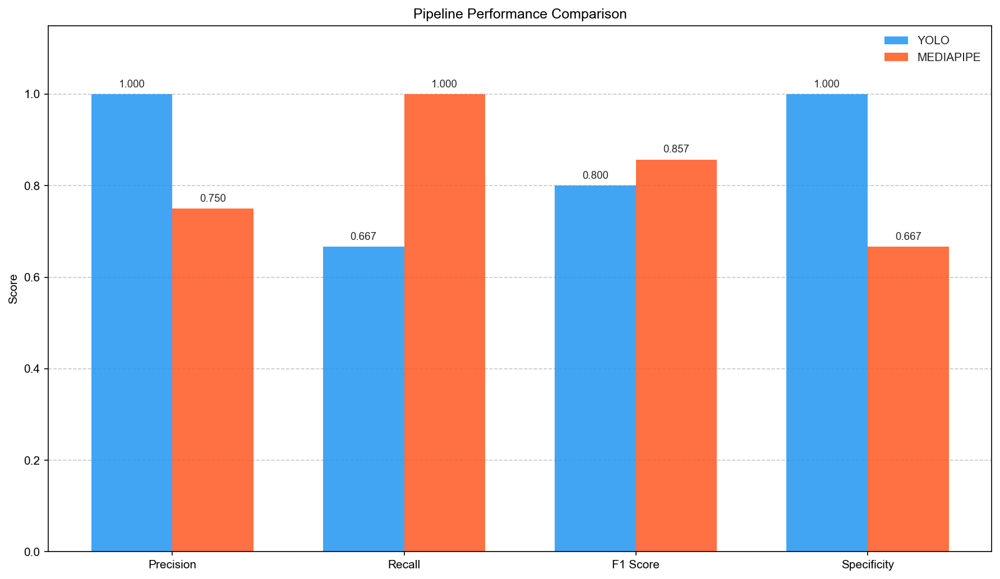
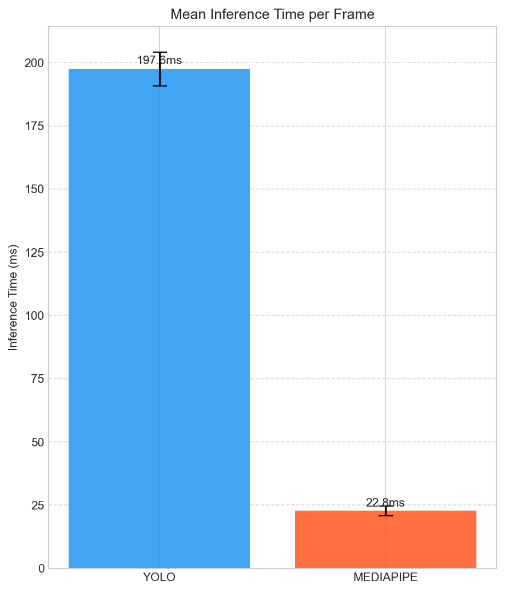
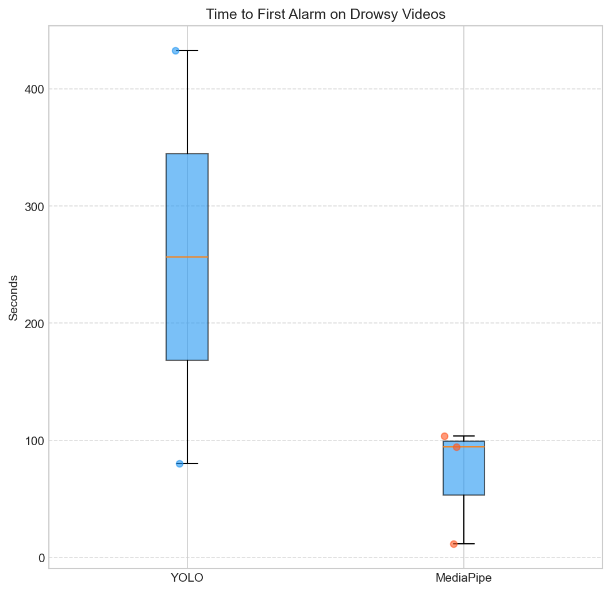
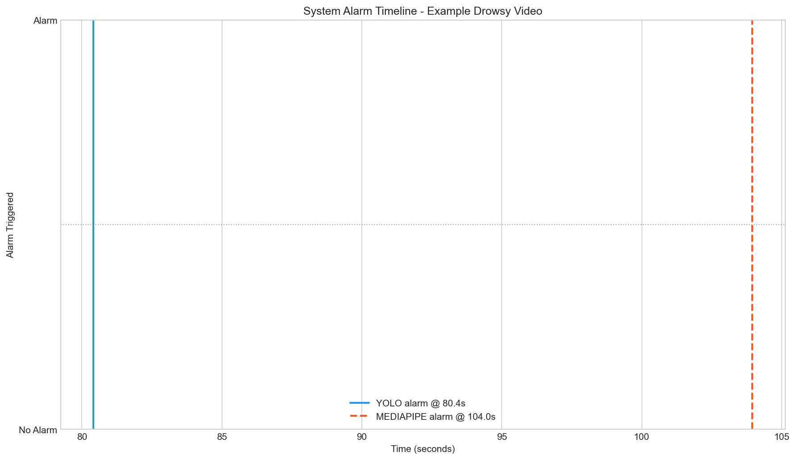
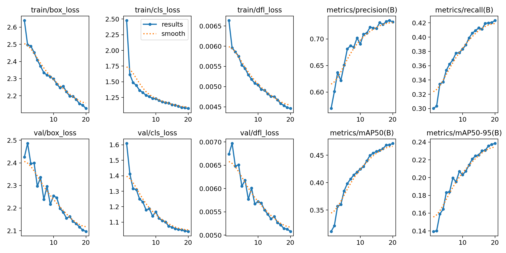
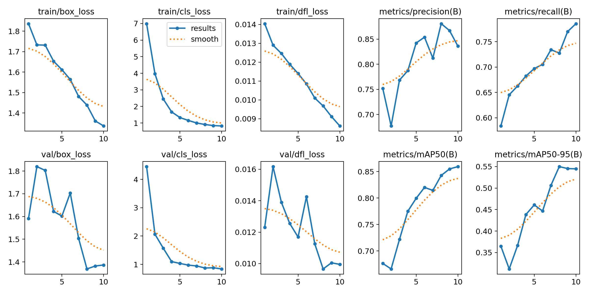
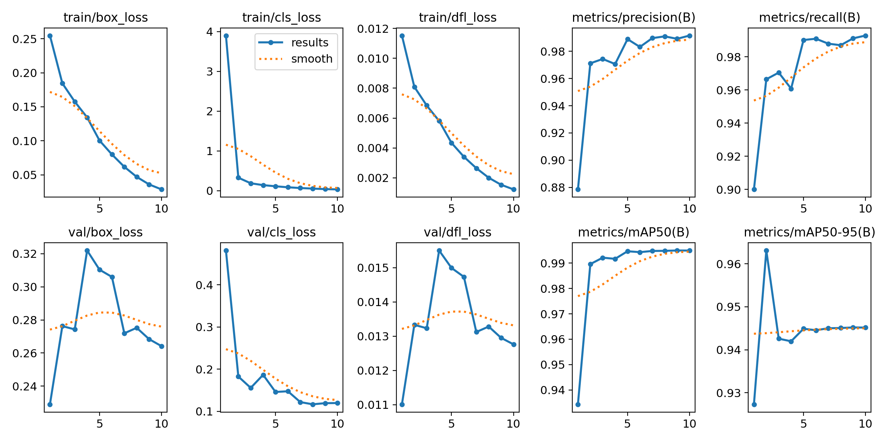
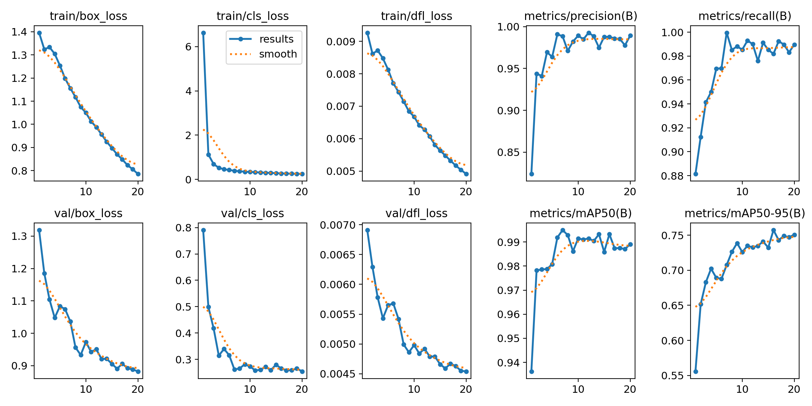

# Drowsiness Detection Pipeline

A complete, reproducible pipeline for **driver drowsiness detection from video** — and a head-to-head comparison of two very different ways to solve it:

| | Approach | Idea |
|---|---|---|
| 🅐 | **YOLO cascade** | Four small YOLO models chained together: locate the face → locate the eyes inside the face crop → classify each eye open/closed → detect mouth state. |
| 🅑 | **MediaPipe geometry** | A single `FaceLandmarker` pass over 478 facial landmarks, reduced to two geometric ratios: **EAR** (eye aspect ratio) and **MAR** (mouth aspect ratio). |

Both pipelines emit the same per-frame signal, feed the same time-based sliding-window aggregator, and are evaluated with the same protocol on the same videos — so the comparison is about the *detection strategy*, not about the plumbing around it.

The repository covers the full lifecycle: **training** the detectors, **evaluating** both pipelines against a labelled video corpus, and a **real-time web application** that runs either pipeline live on a webcam or an uploaded file.

<p align="center">
  
</p>

---

## Results at a glance

Evaluated on held-out videos from [UTA-RLDD](https://github.com/altaga/RLDD) (subjects unseen during training; `drowsiness0` = alert, `drowsiness10` = drowsy, the intermediate `drowsiness5` class excluded).

| Metric | YOLO cascade | MediaPipe (EAR/MAR) |
|---|---|---|
| Precision | **1.000** | 0.750 |
| Recall | 0.667 | **1.000** |
| F1 | 0.800 | **0.857** |
| Specificity | **1.000** | 0.667 |
| False alarm rate | **0.000** | 0.333 |
| Time to first alarm | 256.7 s ± 249.3 | **70.1 s ± 50.7** |
| Inference / frame | 197.6 ms ± 6.7 | **22.8 ms ± 1.9** |

**Takeaway.** The YOLO cascade never cried wolf — zero false alarms across every alert video — but it was cautious enough to miss a genuine drowsy episode and took ~3.7× longer to raise the alarm when it did fire. MediaPipe caught every drowsy subject and reacted far sooner, at the cost of one false alarm in three alert videos, and it ran **8.7× faster** — the difference between comfortable real-time on a CPU and a stuttering 5 FPS.

For a driver-monitoring system where a missed episode is worse than an occasional nuisance alert, the geometric approach wins on every axis that matters. The cascade is the better choice when a false alarm is expensive and latency is not.

<p align="center">
  
  
</p>

<p align="center">
  
</p>

> **On the numbers.** Ground truth is assigned at the *video* level (weak supervision): a "drowsy" video is not drowsy in every frame, so per-video precision/recall measure whether a pipeline eventually fires on the right videos, not per-frame accuracy. The test set is small (6 videos, 3 subjects), so the confidence intervals are wide. Continuous frame-level alarm rates are reported alongside in [`02_testing/results/metrics_summary.txt`](02_testing/results/metrics_summary.txt).

---

## How it works

### Pipeline A — YOLO cascade

```
frame ──► face_detector.pt ──► face crop
                                 │
                 ┌───────────────┴────────────────┐
                 ▼                                ▼
         eyes_detector.pt                 mouth_detector.pt
         (eye regions)                    (open_mouth / closed_mouth)
                 │                                │
                 ▼                                │
        eyes_classifier.pt                        │
        (open / closed)                           │
                 │                                │
                 └──────────────┬─────────────────┘
                                ▼
              drowsy  ⇔  closed-eye conf ≥ 0.5  OR  open_mouth conf ≥ 0.5
```

Localising the eyes inside the face crop before classifying them is what makes the small classifier viable — it always sees a tight, consistently scaled eye region instead of a few pixels in a full frame.

### Pipeline B — MediaPipe landmarks

```
frame ──► FaceLandmarker (478 landmarks) ──► EAR, MAR
                                              │
                            drowsy ⇔ EAR < 0.25 OR MAR > 0.9
```

Uses the modern **Tasks API** (`FaceLandmarker`), not the deprecated `FaceMesh` solution.

### Shared aggregation

A raw per-frame verdict is far too jittery to drive an alarm — a blink is not drowsiness. Both pipelines therefore feed a **time-based sliding window**: an alarm fires only when frames marked drowsy make up at least `drowsy_fraction` of a window of `window_duration` seconds (10 s / 0.8 in evaluation, 2 s / 0.8 in the live demo). The window is measured in *seconds*, not in frame count, so the two pipelines are held to the same standard despite their 8.7× speed difference.

---

## Repository layout

```
01_training/     Train the four YOLO models
02_testing/      Evaluate both pipelines on labelled video, compute metrics, plot
03_demo/         Real-time web application (FastAPI backend + React/TypeScript frontend)
docs/            Training curves and diagnostic figures
```

Each stage is self-contained: its own `config.yaml`, `requirements.txt`, `Makefile`, and `README.md`. They are numbered because that is the order in which they depend on each other, not because you must run them all — the trained weights are committed, so you can go straight to stage 2 or 3.

### 01_training

Four YOLO models, each trained on a purpose-built dataset:

| Model | Task | Dataset | Epochs |
|---|---|---|---|
| `face_detector.pt` | detect | WiderFace | 20 |
| `eyes_detector.pt` | detect (eye regions in a face crop) | `eyes_widerface`, derived from WiderFace by [`create_eyes_widerface.py`](01_training/create_eyes_widerface.py) | 20 |
| `eyes_classifier.pt` | classify (open / closed) | open/closed eyes | 10 |
| `mouth_detector.pt` | detect (open_mouth / closed_mouth) | mouth dataset | 20 |

All four are YOLOv26-nano backbones (~5 MB each) and **ship with the repository** in [`01_training/models/`](01_training/models) — no training run is required to reproduce the evaluation or run the demo.

<p align="center">
  
  
</p>
<p align="center">
  
  
</p>

### 02_testing

Runs both pipelines over every video, samples frames at a fixed interval, applies the sliding window, and produces precision / recall / F1 / specificity / false-alarm rate, alarm latency, inference timing, confusion matrices, and per-video breakdowns. Everything under [`02_testing/results/`](02_testing/results) is committed output from the run reported above.

### 03_demo

A real-time application built around a WebSocket stream:

- **Backend** — FastAPI on port `8000`, `/stream` WebSocket, accepts a webcam feed or an uploaded video file, runs the selected pipeline, returns the annotated frame plus state.
- **Frontend** — React + TypeScript + Vite + Tailwind on port `5173`; pipeline selector, live overlay toggle, status panel with FPS and window state.
- **States** — `alert` / `drowsy` / `distracted` / `no_face`. The `distracted` state comes from gaze direction and is available on the MediaPipe pipeline only.

The interface is in Russian.

---

## Quick start

### Run the live demo

```bash
git clone git@github.com:iiputilo/drowsiness_detection_pipeline.git
cd drowsiness_detection_pipeline
```

Download the MediaPipe face landmarker model (not redistributed here) into `01_training/models/`:

```bash
curl -L -o 01_training/models/face_landmarker.task https://storage.googleapis.com/mediapipe-models/face_landmarker/face_landmarker/float16/1/face_landmarker.task
```

Backend:

```bash
cd 03_demo/backend && pip install -r requirements.txt && uvicorn main:app --host 0.0.0.0 --port 8000
```

Frontend, in a second terminal:

```bash
cd 03_demo/frontend && npm install && npm run dev
```

Then open <http://localhost:5173>.

### Reproduce the evaluation

Download [UTA-RLDD](https://github.com/altaga/RLDD) into `02_testing/datasets/uta_rldd/`, then:

```bash
cd 02_testing && pip install -r requirements.txt && make all
```

### Retrain the models

Datasets are not included — see [`01_training/README.md`](01_training/README.md) for the download links and the expected layout, then:

```bash
cd 01_training && pip install -r requirements.txt && make all
```

---

## Requirements

Python 3.10+ (developed on 3.13), Node.js 18+ for the frontend. A CUDA GPU speeds up training substantially and is effectively required for the YOLO cascade to be usable in real time; both pipelines run on CPU, but only MediaPipe stays comfortably real-time there.

## Datasets

None of the datasets are redistributed in this repository — each stage's README links to the source and documents the expected directory layout.

- **WiderFace** (YOLO format) — face and eye-region detection
- **Open/closed eyes** — eye state classification
- **Mouth state** — yawn / mouth-open detection
- **[UTA-RLDD](https://github.com/altaga/RLDD)** — evaluation videos with per-video drowsiness labels

## License

[MIT](LICENSE)
